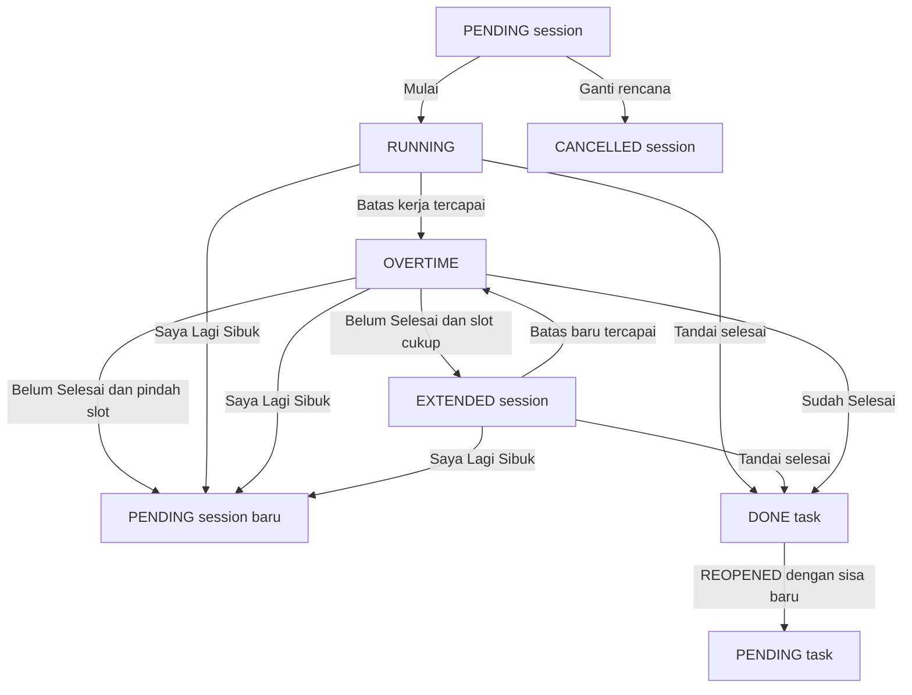

# Spesifikasi scheduler dan timer

Draft v1 Wave 0. Field dan enum mengikuti [kontrak data dan API](DATA_AND_API_CONTRACT.md). Scheduler murni menerima snapshot, `now`, dan zona profil. Repository menerapkan perubahan serta menjadwalkan alarm setelah transaksi Room berhasil.

## Analisis offline

Lowercase judul dan deskripsi dengan locale tetap. Hitung berapa dari `coding`, `makalah`, `presentasi`, `kelompok` muncul sebagai kata utuh, masing-masing maksimal sekali. Tambahkan 1 jika deskripsi setelah trim memiliki 240 karakter atau lebih, dan 1 jika deadline dalam 48 jam atau terlewat. Gunakan `difficultyScore = clamp(1 + jumlahKataDemikian + bonusPanjang + bonusDeadline, 1, 5)`. Gunakan menit `[25, 50, 90, 150, 240]` untuk masing-masing skor. UI meminta konfirmasi dan mengizinkan edit skor serta menit.

## Priority Ranking Engine

```text
untilDeadline = (deadlineAt - now) / 60_000.0
urgency = clamp(remainingMinutes / max(1.0, untilDeadline), 0.0, 1.0)
if now >= deadlineAt: urgency = 1.0
priorityScore = roundHalfUp(1000 * (0.75 * urgency + 0.25 * difficultyScore / 5.0))
rank = priorityScore DESC, deadlineAt ASC, createdAt ASC, id ASC
```

Gunakan rasio terhadap waktu kalender untuk ranking. Hitung kelayakan berdasarkan slot kosong. Hitung ulang ranking saat data berubah dan ketika menit berganti saat layar aktif. Setiap replan mengambil satu snapshot skor agar hasil deterministik. Task `DONE` dikecualikan.

## Slot kosong dan batas sesi

1. Bentuk jam aktif untuk tujuh tanggal lokal mulai dari tanggal `max(now,busyUntilAt)` dan potong rentang pertama pada waktu itu. Gunakan interval setengah terbuka `[start,end)`. Untuk jam lokal dalam DST gap, geser sebesar gap. Saat jam berulang, gunakan offset lebih awal untuk awal interval dan offset lebih akhir untuk akhir interval. Gabungkan interval yang bertumpuk dan buang interval kosong.
2. Potong union `FixedSchedule` termasuk makan, istirahat, ibadah, dan reservasi sesi yang dipertahankan. Bulatkan awal slot ke atas dan akhir ke bawah pada menit absolut. Pertahankan jeda 10 menit setelah sesi terjadwal sebelum sesi fokus berikutnya. Waktu yang telah kosong di antara dua slot, termasuk agenda tetap, dapat memenuhi sebagian atau seluruh jeda itu. Jeda boleh berakhir saat jam aktif tutup.
3. Durasi sesi normal 25–50 menit. Izinkan blok 1–24 menit hanya untuk menyelesaikan seluruh sisa yang belum ditempatkan ketika sisa itu memang di bawah 25 menit. Jangan memecah sesi di batas jadwal tetap. Saat memilih panjang 25–50 menit, hindari menciptakan ekor di bawah 25 jika ada durasi legal yang menghasilkan `0` atau `>=25` menit sisa.
4. Task dengan deadline mendatang hanya mendapat sesi yang berakhir paling lambat pada deadline. Setelah lewat, task bisa dijadwalkan pada slot kosong berikutnya dengan label `OVERDUE`. Beri peringatan jika menit yang terjadwal sebelum deadline kurang dari sisa; untuk deadline di luar horizon, nyatakan cakupan rencana hingga akhir horizon. Refresh horizon pada hari baru, perubahan profil, atau pembukaan aplikasi ketika rencana perlu diperpanjang.

## Weighted Time Allocation

Satu bobot per task adalah `priorityScore`. Kapasitas `C` adalah jumlah menit slot setelah pengurangan interval sibuk. Ini batas atas karena jeda, deadline, dan blok minimum bisa menyisakan kapasitas. `need[i]` adalah sisa menit setelah dikurangi kerja aktif aktual sejak sesi dimulai dan porsi kerja masa depan yang dipertahankan pada task tersebut. Hitung pengurangan dari satu baseline sesuai transisi agar kerja aktif tidak dihitung dua kali. Bila sesi aktif menunggu keputusan, tunda publikasi rencana baru sampai keputusan selesai.

```text
quota = boundedShares(min(C, sum(need)), weight, need)
# boundedShares: cari λ sehingga quota[i] = min(need[i], λ * weight[i])
# Hitung dengan mengunci cap yang tercapai lalu bagi sisa ke task lain.
# Bulatkan turun; distribusikan menit sisa ke pecahan terbesar, tie sesuai rank.

for each free slot in chronological order:
    cursor = first minute allowed by the slot and the preceding focus break
    while cursor is inside slot:
        options = legal chunks of 1–50 min, bounded by unplaced need,
                  slot end and each task's deadline eligibility
        if options is empty: break
        prefer chunks within each task's unspent quota
        within that group choose earlier deadline if it cannot use the next slot
        otherwise choose highest rank with an eligible chunk
        if no chunk fits any unspent quota:
            choose highest rank with an eligible chunk and redistribute unused quota
        choose longest legal chunk for that task, avoiding a short tail when possible
        reserve the chunk; deduct its work minutes from unplaced need and quota
        cursor = chunk end + 10 min
```

Untuk redistribusi, perlakukan menit sesi yang sudah dipesan sebagai tetap. Hitung kembali target sisa hanya untuk ruang dan task yang masih bisa ditempatkan, dengan bobot dan cap yang sama. Bila target hasil hitung masih di bawah minimum, berikan satu blok legal utuh mengikuti rank, lalu hitung kembali setelah blok ditempatkan. Untuk kondisi kelayakan yang sama, jika pemberian blok ke task berperingkat lebih rendah akan membuat totalnya melampaui task dengan skor lebih tinggi, utamakan blok yang legal untuk task berskor lebih tinggi. Porsi bisa menyimpang akibat cap sisa, blok minimum, jeda, deadline, atau reservasi sesi yang sudah dikunci. Luangkan slot untuk task lain jika ada kelayakan. Peringatan menunjukkan defisit menit pada rencana yang benar-benar dibuat; heuristik ini dapat memilih rencana berbeda dari optimasi global.

**Contoh kuota**

1. `C=120`, bobot `750:250`, masing-masing sisa ≥120 → target `90:30` sebelum penempatan.
2. `C=120`, bobot `750:250`, task pertama hanya butuh 30 → target `30:90` setelah redistribusi.
3. Slot 70 menit dengan dua task masing-masing butuh 30 → `30 kerja + 10 jeda + 30 kerja` bila deadline mengizinkan.

## Smart Shift dan Dynamic Reschedule

```text
smartShift(sessionId, revision, extraMinutes, now):
    verify active session, owner, revision and extraMinutes in 1..10080
    finish current segment at now and record actual work
    replace Task.remainingMinutes with extraMinutes  # sisa dari sekarang
    if current slot allows a legal focus block and duration before a hard boundary:
        start an EXTENDED segment capped by remaining continuous focus time and extraMinutes
        reserve 10 min break before another focus block
    else:
        continuation starts in a future legal slot after the required break
    rebuild future PENDING sessions using shared weighted scheduler
    publish deadline-risk warnings

dynamicReschedule(resumeAt, now):
    validate resumeAt >= now
    persist busyUntilAt = resumeAt
    close active segment as interrupted at now and record actual work
    deduct completed whole work minutes from remaining, floor at 1 until user confirms DONE
    cancel unstarted sessions; rebuild from resumeAt around fixed schedules and locked breaks
    publish deadline-risk warnings
```

Pada batas sesi, `Belum Selesai` membuka input `+15 mnt`, `+30 mnt`, `+1 jam`, atau custom. Nilai input merupakan sisa **dari waktu konfirmasi**, sehingga overtime sebelum konfirmasi tercatat sebagai aktual dan dapat memengaruhi estimasi yang dimasukkan user. Terapkan guardrail blok minimum dan deadline untuk extension. Kurangi batas 50 menit fokus kontinu dengan durasi aktual sejak jeda terakhir, termasuk overtime dan extension berurutan. Jika sisa jatah kontinu atau ruang sebelum jadwal tetap tidak cukup, antrekan lanjutan sesudah jeda pada slot legal. Overtime yang sedang diukur boleh melewati jadwal tetap jika user terus membiarkan timer berjalan. Rekam waktu aktual tersebut dan cegah perpanjangan yang direncanakan di dalam blok tetap.

Pada dynamic reschedule, pertahankan histori aktual dan task `DONE`, termasuk timestamp selesai. Shift dan dynamic reschedule membatalkan dan mengganti `PENDING` dalam satu transaksi, mempertahankan sesi yang sudah ditutup, serta mengembalikan daftar alarm yang harus diselaraskan. Segmen extension yang dibuat oleh transaksi adalah reservasi aktif dan diperhitungkan dalam kuota sisa. Gunakan `busyUntilAt` sampai jam tersebut tercapai atau user menggantinya.

## State machine



| Kejadian | Mutasi dalam Room |
| --- | --- |
| Mulai sesi | Hanya dari `PENDING` pada slot legal dengan UID aktif. Set sesi `RUNNING`, Task `IN_PROGRESS`, waktu start, dan cutoff. Jika mulai terlambat, jangan melewati akhir slot rencana. Replan jika durasi legal sudah tidak cukup. |
| Batas kerja | Jadikan `OVERTIME` dengan cutoff asli. Simpan status sekali. Timer menampilkan waktu sejak cutoff selama user belum merespons. |
| Konfirmasi belum selesai | Tutup sesi sumber sebagai `DONE` dengan aktual. Task tetap terbuka. Jalankan Smart Shift, dan buat sesi `EXTENDED` baru atau sesi `PENDING` berikutnya. |
| Konfirmasi selesai | Tutup sesi aktif sebagai `DONE` bila ada. Task `DONE`, sisa 0, simpan `completedAt`, batalkan sesi pending task, dan sarankan sesi berikutnya. User memulai timer berikutnya. |
| Reopen atau interupsi | Reopen mengembalikan status Task ke `PENDING` dan menyimpan sisa baru. Interupsi menutup sesi aktual dan mempertahankan `IN_PROGRESS` pada Task. Keduanya menghitung ulang rencana. |

## Android timer dan pemulihan

1. Start `ForegroundService` dari aksi pengguna. Gunakan countdown persisten dan notifikasi keputusan saat cutoff, dengan aksi **Sudah Selesai** serta deep link **Belum Selesai** ke input waktu. Jika belum ada respons, tampilkan overtime dari cutoff yang sama. Untuk Android 14+, jadikan `specialUse` kandidat awal dan verifikasi subtype, manifest, serta perilaku paket sideload pada Wave 4. [Tipe foreground service](https://developer.android.com/develop/background-work/services/fgs/service-types)
2. Pasang pengingat awal dan cutoff melalui `AlarmManager.setExactAndAllowWhileIdle` saat tersedia. Minta akses `SCHEDULE_EXACT_ALARM` dalam konteks pengingat, pakai `canScheduleExactAlarms()`, dan tangani izin dicabut termasuk race `SecurityException`. Gunakan alarm inexact `setAndAllowWhileIdle` saat akses ditolak dan jelaskan pengingat dapat terlambat. Permintaan `POST_NOTIFICATIONS` berdiri sendiri. Jika ditolak, sediakan keputusan yang sama di UI. Tangani Doze dengan rekonsiliasi timestamp dan uji perangkat. Tampilkan bantuan setting baterai jika diperlukan. [Exact alarms](https://developer.android.com/develop/background-work/services/alarms) · [Doze dan App Standby](https://developer.android.com/training/monitoring-device-state/doze-standby)
3. Timer menggunakan `elapsedRealtime` sebagai sumber durasi dalam boot yang sama. Simpan ID boot, awal dan cutoff monotonic, serta durasi terakhir yang teramati pada checkpoint lifecycle atau aksi. Alarm pengingat jadwal memakai waktu wall-clock. Saat process death atau callback terlambat, rekonstruksi dari Room dan waktu sekarang. Setelah reboot, tutup sesi aktif sebagai interupsi dengan checkpoint terakhir, beri tahu pengguna jika durasi perlu koreksi, dan pasang kembali pengingat dari rencana terbaru. Evaluasi ulang jadwal pada perubahan jam atau zona perangkat.
4. Semua event membawa `ownerUid`, `sessionId`, `revision`, dan jenis aksi. Validasi UID aktif, revision dan status di transaksi Room. PendingIntent memakai identitas unik per event dan immutable. Alarm dan aksi lama menjadi no-op. Jika keputusan valid tiba sesudah cutoff sebelum alarm, selesaikan transisi cutoff dan keputusan dalam transaksi yang sama. Rapikan alarm lama setelah commit. Rekonsiliasi saat app dibuka, saat reboot, dan saat izin exact alarm berubah dapat memperbaiki kegagalan pemasangan setelah commit.

## Kasus penerimaan Core

1. Periksa bobot, cap, tie, redistribusi, sisa kecil, slot pendek, serta pemecahan fokus dan jeda.
2. Periksa deadline yang jatuh di tengah slot, jadwal tetap bertumpuk, jeda di dua interval berbeda, dan perubahan zona/DST.
3. Periksa extension yang pas dan extension yang harus lanjut setelah kuliah, termasuk overtime yang melewati awal kuliah. Contoh sesi mulai 09:25, cutoff 09:50, kuliah 10:00–11:00, dan user meminta +30 pada 09:52. Rekam 27 menit aktual, jadwalkan lanjutan paling cepat 11:00, dan pertahankan blok kuliah.
4. Periksa dynamic reschedule dengan sesi aktif, histori `DONE`, identitas ganda, serta defisit menjelang deadline.
5. Periksa aksi dan alarm duplikat lintas proses, reboot dengan checkpoint, serta kalkulasi histori setelah reopen.
